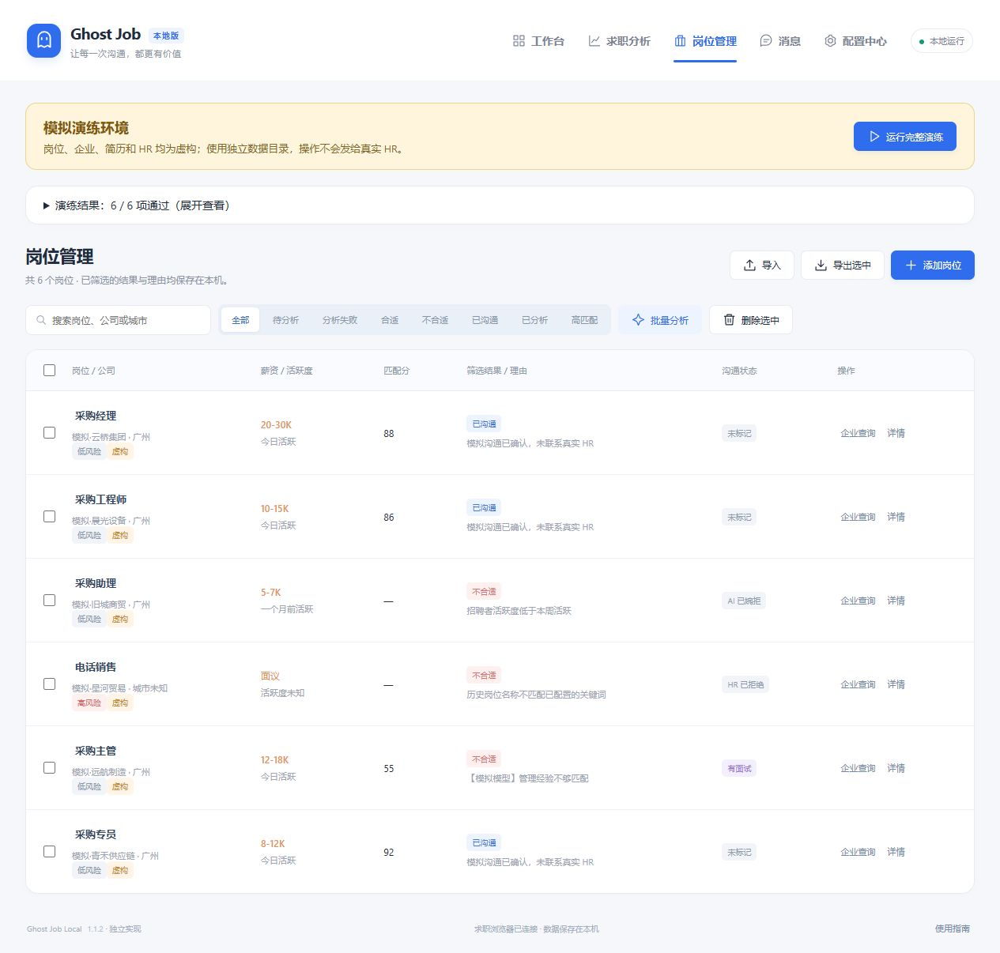
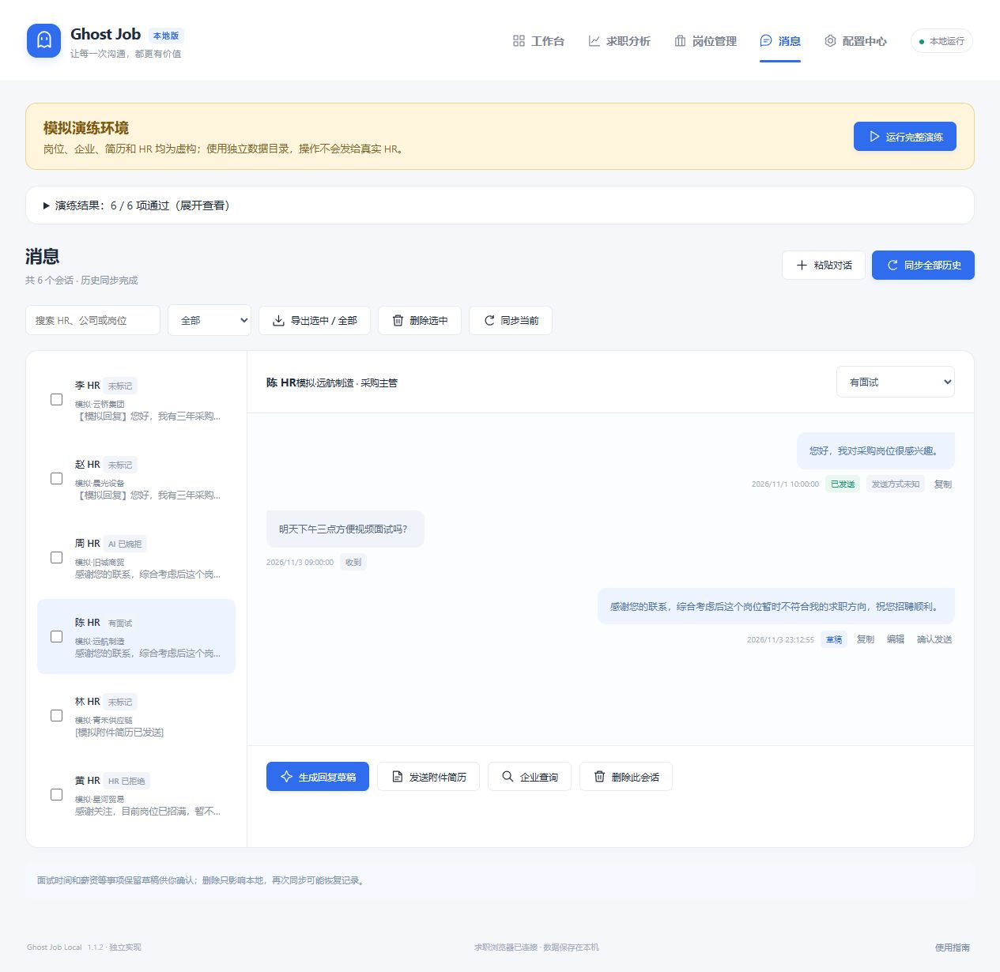
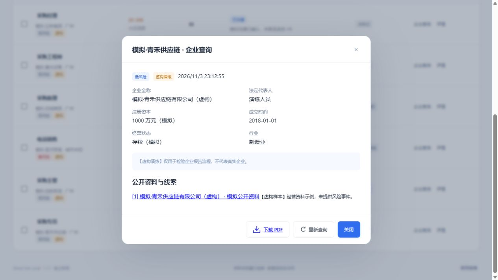

# A border Job

A border Job 是本地自定义品牌。

在自己的 Windows 电脑上运行和修改的求职辅助工作区。提供岗位筛选、消息与草稿、历史会话、企业资料查询、求职统计，以及完全使用虚构数据的模拟演练。

当前 `main` 包含截至 **2026-11-06** 的 A border Job 本地更新：ChatGPT 订阅连接、自然专属招呼与事实核对、已有开场防重复、浏览器连接和前台恢复，以及工作台界面更新。717 项自动化测试通过。

此次更新为源码，历史 Release 便携包尚未重新发布。运行最新源码需要 Node.js 24 或更高版本：在项目目录执行 `node server.mjs --open`；运行隔离演练执行 `node server.mjs --simulate --open`。项目不需要安装 Node 第三方依赖，首次使用请自行配置简历和 AI 服务。本机数据与登录凭据不随仓库分发。

**这是根据公开功能独立实现的本地版本，不是原版 Ghost Job 的官方发行版。** 功能参考：[InfernalAzazel/ghost-job](https://github.com/InfernalAzazel/ghost-job)。

[下载 Windows 便携版](https://github.com/xiaobaikekishuo/ghost-job-local/releases/latest) · [查看安装步骤](#windows-安装无需编程环境)

## 界面演示

以下是 **v1.1.2 实际运行截图**，来自独立模拟环境。岗位、企业、HR、简历和统计均为虚构演练数据，不代表实际求职结果。点击图片可以查看原图。

### 工作台

集中查看投递、回复、运行日志与演练结果；从这里开始岗位读取和消息处理。


<details>
<summary><strong>岗位管理：匹配分、筛选理由与沟通状态</strong></summary>

按状态筛选岗位，查看匹配分与筛选理由，并支持导入、导出和企业查询。



</details>

<details>
<summary><strong>消息与草稿：历史会话、面试状态和人工确认</strong></summary>

集中查看历史会话、标记面试进度；回复草稿可编辑，确认后再发送。图中展示待确认草稿。



</details>

<details>
<summary><strong>企业查询：资料、来源线索和 PDF 导出</strong></summary>

展示企业资料、资料来源与风险提示，可导出 PDF。此图为虚构企业样本。



</details>

<details>
<summary><strong>求职分析：统计快照、回应率与样本提示</strong></summary>

保存统计快照，查看回应率估计、置信区间和样本量，支持解读与 PDF 导出。


</details>

## Windows 安装：无需编程环境

1. 打开本仓库右侧 **Releases**，进入最新版本。
2. 在 **Assets** 下载 `GhostJob-Local-v1.1.2-windows-x64.zip`。普通使用请选择这个文件；GitHub 自动提供的 `Source code` ZIP 不含运行环境。
3. 在文件资源管理器中右键 ZIP → **全部解压**。将里面的 `GhostJob-Local` 文件夹放到自己选择的位置，例如 `D:\GhostJob-Local`。
4. 电脑需要安装 [Google Chrome](https://www.google.com/chrome/)。双击解压目录中的 **Start.vbs**，成功后会出现工作台。
5. 如果没有出现窗口，双击 **Start.cmd** 查看提示。没有安装 Codex、Node.js 或 Python 也可以运行 Windows 便携版。

适用 Windows 10/11 x64。运行环境随包携带；无需管理员权限，无需 npm 安装。程序只监听本机 `127.0.0.1`，不需要部署服务器。

## 第一次先模拟

双击 **模拟演练.vbs**，看到黄色“模拟演练环境”标志后点击 **运行完整演练**。成功后会显示 **6 / 6 项通过**，可以查看虚构岗位、HR 消息、企业报告和统计。

模拟环境不登录 BOSS、不调用外部 AI、不联系真实 HR，与正式数据目录隔离。

## 正式使用

1. 配置中心填写求职方向、城市、简历及自己的 AI 服务配置。
2. 工作台打开求职浏览器，在 Chrome 中自行登录 BOSS。
3. 先读取岗位、分析并人工核对结果。默认不会自动发送。
4. 涉及面试时间、薪资等内容保留草稿，用户确认后再处理。

网页适配会随 BOSS 页面变化而需要维护。已通过本地业务测试、DOM 样本和隔离模拟；**不能把模拟通过理解为所有真实网站操作都已验证**。新版消息页会通过当前职位弹窗的公开岗位链接核对 HR，再读取消息回执。无法可靠核对 HR 与岗位时，不发送专属文案；同一会话已有本人开场（包括 BOSS 固定开场）时，不再追加。

「专属招呼不可用时继续投递」（`greetingFallback`）默认开启，**仅对自动任务生效**。开启后，已知可恢复的专属招呼问题可回退为点击「立即沟通」，并继续处理后续岗位；必要时本轮暂停专属招呼，只发起平台沟通。**发起平台沟通不代表 BOSS 默认消息或专属招呼已经送达。** 已生成的文案保留在本机，不能据此认定已发送。关闭该开关时，专属招呼检查失败会跳过当前岗位，或本轮仅继续筛选。岗位详情中的手动专属发送及带专属招呼的沟通按钮仍严格检查，不因该开关而回退。

若暂停专属招呼的原因明确只是消息页未切到前台（`CHAT_NOT_FOREGROUND`），自动任务会显示「等待恢复专属招呼」：在第 3 个后续新合适岗位沟通前进行首次只读恢复检查，仍未恢复则再间隔 6 个，本轮最多检查 2 次。界面显示距下次检查的岗位数。检查通过后，仅恢复后续新岗位的专属流程，仍要核对 HR、岗位与已有消息；不会补发旧岗位。身份不明、已有开场或发送回执不明的保护不会因此解除。检查次数用尽或原因不可恢复时，本轮仍仅发起平台沟通。

用户取消（`CANCELLED`）会停止；登录失效、安全验证、平台限制、每日上限、浏览器断开及未知传输异常仍会暂停。明确的单次点击确认超时会标记「待核实」并跳过，连续出现则暂停；已尝试的专属招呼回执超时会保留「待核实」，开启回退时本轮不再发送新的专属招呼。不要盲目补发待核实消息。重新开始前请查看原因、保留文案和 BOSS 已有消息，已发送、待核实或已有开场的记录不会自动重发。详细边界见 [`持续投递修复说明.md`](持续投递修复说明.md)。

岗位职责和任职要求从详情页读取，搜索列表不会覆盖已取得的正文。旧版摘要会在下一次分析或生成招呼时重新读取；无法取得有效正文时不会用列表标题冒充岗位要求。

专属招呼由当前选择的 AI 服务撰写：先选取岗位最相关的 1–2 项要求与简历事实，再写成自然的短招呼，并通过独立推理核对有无夸大或无依据的声明。正常生成包含撰写与核对两次 AI 请求，均使用所选服务的额度。新草稿会在详情中显示生成来源和模型；事实核对降低错误风险，但不能保证模型判断绝对正确，可在发送前预览原文依据。未发送的旧版草稿下次准备时重新生成，已发送、待核实或已有开场的记录不会重发。

详细功能和操作见 [`使用说明.txt`](使用说明.txt)。

## 保存数据与换电脑

- `data/`：正式数据，包括配置、聊天、岗位、加密密钥与专用浏览器资料。
- `data-simulation/`：独立的虚构演练数据。
- 关闭界面后服务仍在后台；完全退出请双击 **Stop.cmd**。
- 备份前先停止服务，再自行保存整个 `data/` 文件夹。**不要上传这个文件夹到公开仓库。**
- 换电脑后重新下载便携包，按需迁移自己的备份并重新登录；浏览器登录状态可能不能跨机器迁移。
- 更新时先 Stop.cmd 并备份，解压新版本到新文件夹，再迁入自己的数据。不要同时启动两个正式实例。

公开发布包只有程序、虚构测试样本和运行环境；不包含任何实际简历、API Key、聊天、数据库或浏览器登录资料。

## 开发与打包

源码运行需要 Node.js 24+，PDF 导入另需 Python 或完整便携包中的 `runtime/python/`。

```powershell
node server.mjs --open
node server.mjs --simulate --open
node --test tests/*.test.mjs
```

Windows 下重新构建便携包：

```powershell
powershell -NoProfile -ExecutionPolicy Bypass -File scripts/build-release.ps1
```

脚本从 Node.js / Python 官方来源下载固定版本，校验 SHA-256 后打包，产物在 `dist/`；也可通过 `-CacheDirectory` 使用已校验的下载缓存。打包采用文件白名单，不会包含工作数据。

版本：**1.1.2**。保留 1.1.1 的 8 项稳定性修复；新增可重装的完整 Windows 便携分发、内置 PDF 运行环境和通用启动器。

## 来源与许可

见 [`THIRD_PARTY_NOTICES.md`](THIRD_PARTY_NOTICES.md)。自有代码当前未指定开源许可证；第三方组件保留各自许可。
